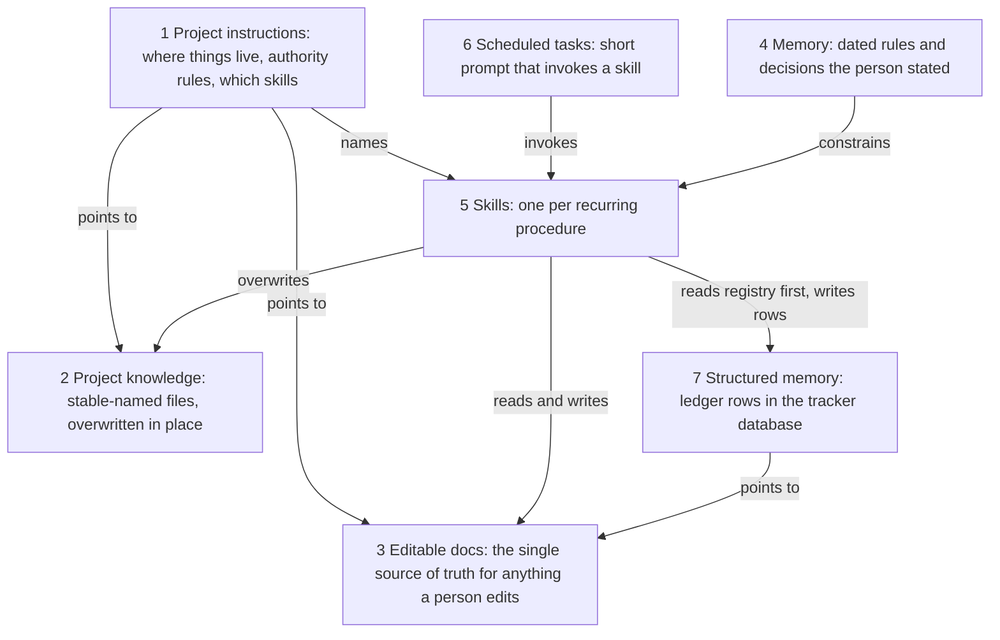
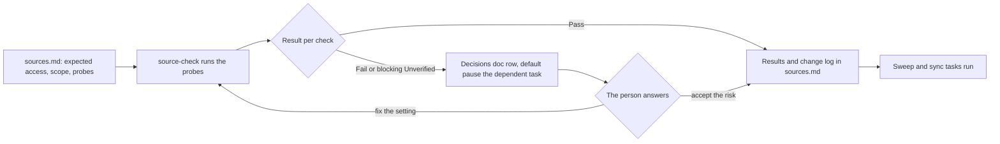
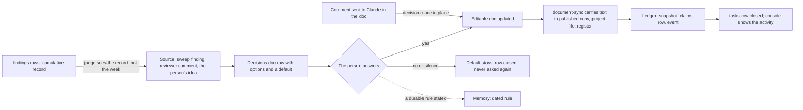

# Architecture

The pattern has seven layers. Each has one job, and each job lives in exactly one layer. Three authority rules and three retrieval rules hold them together. This page says what lives where, why, and how a change moves through.

v1 had six layers. v2 adds the seventh, **structured memory**: a ledger of rows in the tracker artifact's database. The full schema is in [structured-memory.md](structured-memory.md).

## The seven layers

| Layer | Holds | Changes how often | Owner |
| --- | --- | --- | --- |
| Project instructions | where things live, authority rules, which skills | rarely | the person |
| Project knowledge | stable-named files: register, sweep axes, per-document sources, skill fallbacks | per pass, in place | skills |
| Editable docs | statements, Decisions doc, Contact log, evidence tracker, approved summary | daily | the person and Claude |
| Memory | dated rules and decisions the person stated | when the person decides something | background pass |
| Skills | one per recurring procedure | when a procedure changes | the person, via skill cards |
| Scheduled tasks | short prompt + skill, cheap model, few connectors | weekly or nightly runs | the person |
| Structured memory | registry, snapshots, events, tasks (working memory), claims (provenance), findings (research record), meta | every task and run | skills, through project-ledger |

### 1. Project instructions

Short: under 500 words. They say where things live, state the authority rules, name the skills that apply, and set one task per chat. They point to files instead of copying them, because every chat reads the instructions in full. Start from [templates/project-instructions.md](../templates/project-instructions.md).

Why short: context is a budget. Anthropic's guidance on [context engineering](https://www.anthropic.com/engineering/effective-context-engineering-for-ai-agents) is to load the smallest set of high-signal tokens and fetch the rest just in time.

### 2. Project knowledge

A small set of files with **stable names**: `register.md`, `sweep-axes.md`, one source file per document, `ledger.md`, `evidence-tracker.md`, `summary.md`. Each is overwritten in place, and its version is written inside the file (front matter), not in the filename.

Why stable: when a project's knowledge grows past what fits in context, Claude searches it ([RAG for Projects](https://support.claude.com/en/articles/11473015-retrieval-augmented-generation-rag-for-projects)). Ten dated copies of one statement mean search can return the wrong one. History already lives in the editable doc's version history.

The one exception is the weekly sweep report, `sweep-<YYYY-MM-DD>.md`: one report per week is history, not a version of one thing.

### 3. Editable docs

One editable doc (a Claude Doc or equivalent, see [Get started with Claude Docs](https://support.claude.com/en/articles/16923645-get-started-with-claude-docs)) per thing a person edits:

- each controlled document (a statement, an essay, a handbook section)
- the **Decisions doc**: every question waiting on the person, with options and a default ([template](../templates/decisions-doc.md))
- the **Contact log**: the only record of outreach ([template](../templates/contact-log.md))
- the **evidence tracker**: one tab per theme, updated after each sweep
- the **approved summary**: the statement of direction every other document must agree with

Why one: copies multiply writes. Edits happen in the doc; the copies follow through document-sync.

### 4. Memory

Dated rules and decisions the person stated, in their words: "2026-10-02: never name my previous employer in a statement." Memory never holds status that changes weekly (which email was sent, which version is current). Status lives in the docs, where it is visible and correctable.

### 5. Skills

One per recurring procedure, each short (well under the 500-line ceiling in the [skill authoring best practices](https://platform.claude.com/docs/en/agents-and-tools/agent-skills/best-practices)). Each ends its open questions as rows in the Decisions doc, never in chat. See [skills/README.md](../skills/README.md).

### 6. Scheduled tasks

Short prompts that invoke a skill. The cheapest model that can do the job. Only the connectors the task needs, because included connectors can use every tool, writes included, without asking during a run ([scheduled tasks](https://code.claude.com/docs/en/routines)). See [model-and-usage.md](model-and-usage.md).

### 7. Structured memory

A small database in the tracker artifact, read and written by Claude as the person, and shown live on a [console page](../templates/console-page.html). It holds machine state the docs should not: the registry of every controlled document, one working-memory row per chat or run, the provenance of every cited fact, and every identifier a sweep has ever seen. The collections are `programs`, `snapshots`, `events`, `tasks`, `claims`, `findings` and `meta`. The project-ledger skill is their steward.

Why rows: status in prose rots. A row has a timestamp, a source and an author, can be queried without loading prose, and can be listed to disk instead of into context. See [structured-memory.md](structured-memory.md) and [working-with-data.md](working-with-data.md).

## Three tiers of memory

| Tier | Holds | Store | Why there |
| --- | --- | --- | --- |
| Working (one task) | what this chat or run read (doc and revision), decided, changed, left open | a `tasks/<id>` row | a new chat resumes from the row and reads only deltas |
| Project (months) | documents, decisions, contacts, evidence and their history | editable docs for anything a person edits; rows for machine state | docs give version history, comments and human editing; rows are queryable, timestamped and read without loading prose |
| Rules (durable) | dated rules in the person's words | memory | unchanged from v1 |

The rule that holds it together: **status never lives in prose or in memory; it lives in a row with a timestamp and a source.**

## The test layer for sources

When a project reads from connectors, MCP servers, APIs or a database, a test layer sits across the seven layers. It adds no new kind of thing; it is built from the same parts:

| Part | Layer it lives in | Job |
| --- | --- | --- |
| `sources.md` | project knowledge (stable file) | what each source may do, and the probes that prove it |
| source-check | skills | runs the probes: reachable, shape, scope, tools, write refusal, secrets, task hygiene |
| the check task | scheduled tasks | runs before the tasks that depend on the sources, on the cheapest model, carrying only the connectors under test |
| failure rows | editable docs (Decisions doc) | each failure, with the default "pause the dependent task" |

The authority rules hold here too. The check proposes and never repairs: it does not enable a write, widen a scope or paste a credential to turn a Fail into a Pass. A check that cannot run is Unverified, not Pass, for the same reason a green task status is not success. See [connectors-and-mcp.md](../extensions/connectors-and-mcp.md#testing-sources) and [prompt 07](../prompts/07-test-connectors-and-mcp.md).

## The three authority rules

1. **The person's words win** over any older text: a doc, a file, memory, a source.
2. **Propose, wait for yes, then apply.** Nothing in a controlled document changes without the person's approval.
3. **Sync carries text and never revises facts.** If something looks wrong during sync, it becomes a Decisions-doc row.

## The three retrieval rules

1. **Registry first.** A task reads its `programs/<id>` row (and `tasks/` when resuming) before any document or file, then reads only deltas: `sinceRev` on a doc, `lastSeenSweep` on findings, events by `at`. Exact-text search confirms a paragraph is there before anyone says it is.
2. **No claim without a row.** A cited fact that reaches a controlled document has a claims row with its source and verification date. Whole-block writes carry the block hash and revision from a real read, so a write from a stale view fails instead of landing.
3. **New is not important.** A finding changes a document only if, judged against the cumulative findings that touch the same sentence, it moves the picture. `atRev` gives the document as it stood when a decision was recorded. Closed decisions stay closed; a change of mind is a new row.

## Comments as the inbox

A comment the person sends to Claude in a controlled doc is a decision made in place. Claude applies it in that thread, writes a tasks change line and an event, replies in the thread, and adds a Decisions-doc row only when the change needs a yes on something else. A comment's content never moves into memory.

## How a change flows

Every change, whatever its source, passes through one approval and lands in one editable doc; the copies follow, and the record keeps what happened.

The stations: source, Decisions doc, approval, editable doc, sync, ledger, closed tasks row. Only the approval needs the person. A comment sent to Claude is an approval given in place, so it goes straight to the editable doc. The findings rows feed the source station: a sweep finding becomes a Decisions-doc row only when the cumulative record says it moves the picture.

## What lives where, and why

| Question | Answer lives in | Ledger row | Not in |
| --- | --- | --- | --- |
| What is the current text of the statement? | its editable doc | `snapshots/<program>-<key>` (as last carried) | a dated file, memory |
| Which version is current, how many words, does it fit? | `register.md` | `programs/<id>` | memory, chat |
| Did I email Dr. Example? | Contact log | none | memory, an earlier chat |
| What am I waiting to decide? | Decisions doc | `events` with `decisionId` (pointers only) | a sweep report, a tracker note |
| What did this week's sweep find? | `sweep-<date>.md` | `findings` with `lastSeenSweep` = this week | the evidence tracker (it holds the synthesis) |
| Never name my old employer | memory, as a dated rule | none | the Decisions doc (it is not pending) |
| How to run the sync | `skills/document-sync/SKILL.md` | none | project instructions |
| When the sync runs | a scheduled task | `meta/config` | the skill |
| Does the Drive connector still work, and is it still read-only? | `sources.md` results, written by source-check | none; the ledger probe covers only the ledger itself | memory, an earlier chat |
| Where was this chat up to? | the newest `tasks` row | `tasks/<YYYY-MM-DD>-<slug>` | memory, a long chat |
| Where does this cited number come from? | the doc sentence | `claims/<program>-<key>-<nn>` | memory, the sweep report alone |
| Has the sweep seen this paper before? | the findings collection | `findings/<identifier>` | a prose ledger loaded whole |
