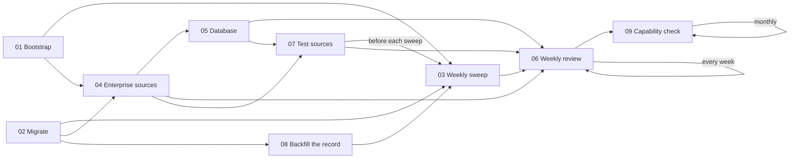

# Starter prompts

Nine copy-paste prompts. Each is self-contained: paste it into a chat in your Claude Project, answer its numbered questions in one reply, and it says what it will create before creating anything. The files hold only the prompt text, so you can copy a whole file.

| # | Prompt | Use it when | Creates or changes |
| --- | --- | --- | --- |
| 01 | [Bootstrap a project](01-bootstrap-project.md) | Starting a new campaign | Decisions doc, Contact log, one editable doc per document, stable project files, the tracker artifact with its console page and ledger, the first tasks row, project instructions, dated memory rules, scheduled tasks |
| 02 | [Migrate an existing project](02-migrate-existing-project.md) | You already have a project full of dated copies and status in memory | Stable files, the two docs, the ledger (backfilled by script), trimmed memory, shorter task prompts; deletes only after you confirm |
| 03 | [Set up the weekly sweep](03-set-up-weekly-sweep.md) | You want new papers, postings or updates found every week | `sweep-axes.md`, the sweep task, an optional post-sweep task, one test run |
| 04 | [Connect enterprise sources](04-connect-enterprise-sources.md) | Your documents live in Drive, SharePoint, Notion, Confluence or Slack | A sync rule per source, security rules, one read-only test per source |
| 05 | [Add a database](05-add-a-database.md) | Figures for the sweep or a skill live in a database | A read-only role (you run the SQL), an `.mcp.json` entry, named queries, a write-refusal test |
| 06 | [Weekly review](06-weekly-review.md) | Once a week, or before a deadline | Nothing until you answer; then each answer goes through the skill that owns it |
| 07 | [Test connectors and MCP](07-test-connectors-and-mcp.md) | After 04 or 05, after any source changes, or when a sweep comes back thin | `sources.md`, one supervised test run, Decisions-doc rows for failures, an optional scheduled check |
| 08 | [Backfill the record](08-backfill-the-record.md) | A project has prose records (a sweep ledger, a register) and is moving to the ledger | `findings` and `programs` rows by script, marked `ledger-transcribed`; the backfill record in `meta/ledger` |
| 09 | [Capability check](09-capability-check.md) | Monthly, or when a new Claude version or feature is out | A numbered proposal for the repo and the project; nothing until you approve; an optional monthly task |

## How they fit together

- Run **01** or **02**, never both. 01 starts clean and creates the tracker, console page and first tasks row; 02 audits what you have, deletes only what you confirm, and builds the ledger.
- **03**, **04** and **05** extend a project that already has a Decisions doc and Contact log. Each needs the files 01 or 02 created.
- **07** tests what 04 and 05 connected, and keeps testing it on a schedule so a broken source surfaces before a sweep or sync relies on it.
- **08** follows 02 when the old project kept a prose sweep ledger or register: it turns them into ledger rows by script, so the sweep stops loading prose.
- **09** keeps the pattern current: it compares what Claude offers now with [docs/capabilities.md](../docs/capabilities.md) and proposes changes.
- **06** is the habit. It reads everything the others built and asks you only what blocks the nearest deadline.

The prompts point at this repository for the templates and skills. If you forked it, change the repository address in each prompt to your fork.
